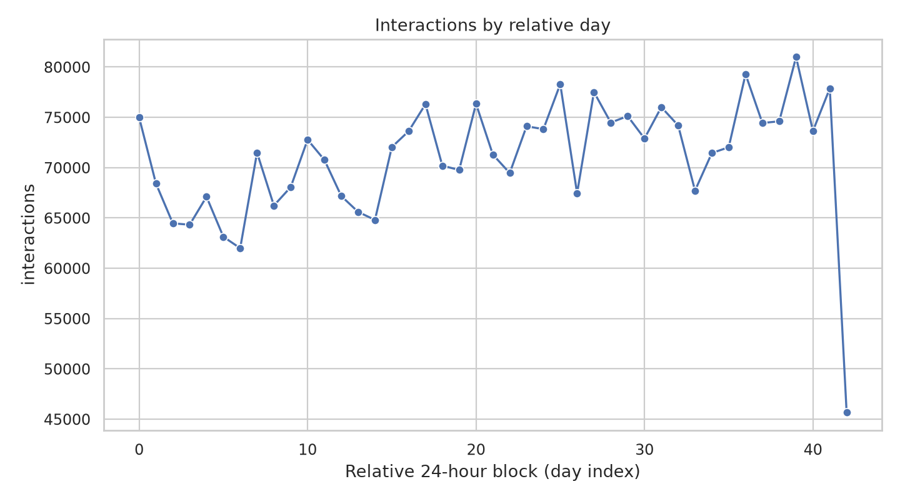
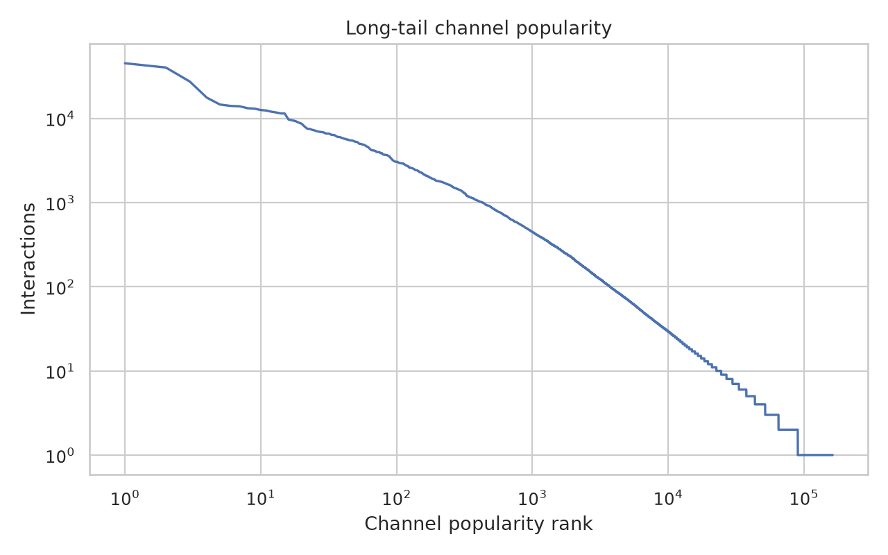
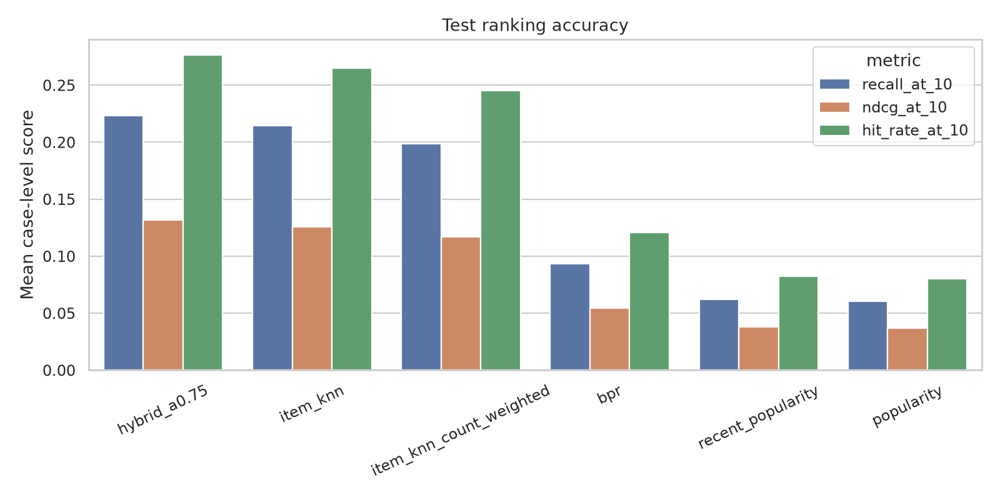

# Twitch 新頻道推薦系統：方法、實驗與結果分析

## 摘要

本專案研究的問題是：**能否根據 Twitch 使用者過去的觀看紀錄，推薦 10 個他從未看過、但未來可能會觀看的新頻道？** 我們使用 UCSD 公開的 Twitch 互動資料，依時間先後切分訓練、驗證與測試區間，避免模型在訓練時看見未來資料。實驗比較整體熱門度、近期熱門度、ItemKNN、Bayesian Personalized Ranking（BPR）及兩者的 Hybrid，並同時衡量準確度、多樣性、冷啟動與大規模擴展能力。

在官方 100k 使用者資料上，Hybrid 的 Recall@10、NDCG@10 分別為 **0.22342、0.13148**，優於 ItemKNN 的 **0.21437、0.12584**，也明顯優於 BPR 的 **0.09328、0.05420** 與熱門度基準的 **0.06068、0.03702**。Hybrid 相對 ItemKNN 的提升不大，但 user-clustered bootstrap 的 95% 信賴區間不包含 0，因此在本離線測試 protocol 下具有統計顯著性。然而，ItemKNN 的頻道覆蓋率與新穎度比 Hybrid 高，顯示準確度與多樣性之間存在取捨。

一百萬使用者的擴展實驗並未讓所有模型都進步：ItemKNN 的 NDCG 約增加 3.05%，Hybrid 幾乎持平，而 BPR 約下降 19.94%。這個結果不能解讀為純粹的資料量因果效果，因為 cohort、候選頻道庫與測試樣本也同時改變；但它顯示「更多互動資料」不一定能自動解決稀疏度、負樣本品質與動態直播可用性等問題。

---

## 1. 資料集與探索性資料分析（EDA）

### 1.1 資料來源與規模

資料來自 UCSD McAuley Lab 的 Twitch 公開資料集。原始研究每 10 分鐘記錄連接至各直播聊天室的使用者，並提供匿名使用者 ID、stream ID、實況主名稱、開始與停止 time slot。官方資料頁與原始論文皆指出，資料涵蓋 43 天，目的在研究直播平台的動態可用性與重複觀看行為（[UCSD dataset page](https://cseweb.ucsd.edu/~jmcauley/datasets.html#twitch)；[Rappaz et al., 2021](https://cseweb.ucsd.edu/~jmcauley/pdfs/recsys21b.pdf)）。

本專案主要使用官方 100k subset：

| 性質 | 數量 |
|---|---:|
| 使用者 | 100,000 |
| 頻道（item） | 162,625 |
| 觀看互動 | 3,051,733 |
| 直播 session | 739,991 |
| 相對日數 | 43 |
| 缺失值 | 0 |

平均每位使用者約有 30.5 筆互動，但 user-channel 矩陣的理論大小超過 162 億格，實際觀察到的互動只佔極小比例，因此這是一個**高度稀疏的 implicit-feedback 推薦問題**。資料沒有星等；「看過」表示一個正向訊號，「沒看過」則可能是不喜歡、不知道該頻道，或當時頻道根本沒有直播。

### 1.2 資料品質與前處理

資料品質檢查沒有發現缺失欄位、完全重複列、結束時間早於開始時間、零時長、非正使用者 ID 或空白頻道名稱。主要前處理如下：

1. 將原始 10 分鐘 time slot 換算為相對 24 小時 day index：
   `day = floor((time_start - min(time_start)) / 144)`。
2. 以 streamer username 作為推薦 item；stream ID 只用於品質檢查。
3. 建立稀疏的 user-channel 矩陣，主要版本將多次觀看二值化為「看過／沒看過」。
4. 只使用 fit period 出現過的使用者與頻道建立 index，避免未來資訊洩漏。
5. 產生推薦時排除使用者已看過的頻道。

時間是相對 time slot，不是真實日期，因此本報告不將 day index 解讀為星期幾或特定日曆日期。

### 1.3 EDA 的重要發現

EDA 顯示三個與模型選擇直接相關的現象：

1. **頻道熱門度呈長尾分布。** 少量熱門頻道獲得大量互動，多數頻道只有少量觀眾。因此只推薦熱門頻道可能有不錯的基本命中率，卻會犧牲個人化和小型頻道曝光；這也是本專案同時回報 catalog coverage、novelty 與 long-tail exposure 的原因。
2. **重複觀看會隨時間累積。** 直播平台有明顯的回訪行為，但本專案的研究問題是「發現從未看過的新頻道」，因此主要特徵使用 binary user-channel feedback，而不是讓多次觀看完全主導分數。
3. **新頻道冷啟動不可忽略。** 測試期的新 user-channel positives 中，約 88.02% 的頻道曾出現在 fit catalog；約 12% 是模型訓練時完全未出現的頻道，純協同過濾無法對它們學到可靠表示。

這些 EDA 發現解釋了特徵與模型選擇：長尾分布要求我們比較熱門度與個人化模型；高稀疏度適合稀疏矩陣及 ItemKNN；重複觀看則促使我們做 binary 與 count-weighted 的 feature ablation；動態與冷啟動問題要求時間切分、candidate coverage 和近期活躍頻道敏感度分析。

---

## 2. 預測任務、特徵與評估設計

### 2.1 預測目標

對每位已知使用者產生一份 Top-10 清單，推薦他在 fit period **從未看過**的 Twitch 頻道。若使用者在 target period 第一次觀看某個不在其歷史中的頻道，該 user-channel pair 就是一個正確答案；重複觀看既有頻道不算本任務的 positive。

這是 ranking task，而不是預測星等或單一的成功／失敗分類。模型必須為大量候選頻道排序，再取前 10 名。

### 2.2 特徵表示

本專案沒有頻道類別、語言、遊戲名稱或文字描述，因此核心特徵來自觀看行為：

- **Binary user-channel matrix：** 看過為 1，否則為 0；這是主要表示。
- **Count-weighted matrix：** 保留重複互動次數，作為 feature ablation。
- **Distinct-user popularity：** 每個頻道有多少不同觀眾，避免同一位重度使用者重複觀看造成熱門度膨脹。
- **Recent popularity／active mask：** fit period 最後 7 天的觀看訊號，作為近期活躍代理。
- **Latent factors：** BPR 從 binary matrix 學習 64 維 user/item embeddings。

測試結果支持 binary 表示：binary ItemKNN 的 NDCG@10 為 0.12584，高於 count-weighted ItemKNN 的 0.11694；差值的 paired bootstrap 信賴區間也不包含 0。這表示在「新頻道發現」任務中，知道使用者接觸過哪些不同頻道，比放大反覆觀看次數更有效。

### 2.3 時間切分與防止資料洩漏

43 個相對日期依序切成：

| 區間 | Day | 用途 |
|---|---|---|
| Train | 0–29 | 訓練候選模型 |
| Validation | 30–35 | 選超參數與 Hybrid 權重 |
| Test | 36–42 | 最終一次評估 |

所有 channel mapping、熱門度、ItemKNN 相似度與 BPR parameters 都只從 fit period 計算。先用 Train 調參，再以 Train + Validation 重新訓練，最後只評估一次 Test。這比隨機切分更符合部署情境，也避免把未來觀看行為洩漏進模型。

### 2.4 評估指標

- **Recall@10：** 使用者真正觀看的新頻道中，有多少出現在前 10 名。它重視「找回多少」，但不區分正確答案排第 1 或第 10。
- **NDCG@10：** 同時考慮命中與排名位置；正確頻道越靠前，分數越高。本專案以 validation NDCG@10 選參數。
- **Hit Rate@10：** 每個案例的前 10 名是否至少命中一個 positive。
- **Catalog Coverage：** fit catalog 中，有多少不同頻道至少被推薦一次。它衡量推薦廣度，不直接衡量正確性。
- **Novelty：** 以頻道 distinct-user popularity 計算 self-information；越高表示越不像只推主流熱門頻道。
- **Long-tail Exposure：** 推薦結果中屬於低熱門度頻道的比例。
- **Candidate Coverage：** 真實新頻道中有多少存在於 fit catalog；它反映模型在冷啟動限制下理論上能否推薦該答案。

### 2.5 統計有效性

主要日層級測試包含 53,212 位 eligible users、104,818 個 user/day cases。同一位使用者可能出現多天，因此不能把每個 case 當成完全獨立。本專案以使用者為 cluster 做 10,000 次 paired bootstrap，抽到某位使用者時保留其全部 cases，並使用 Holm correction 控制多重比較的 family-wise error。

另外也將整個 Test period 的新頻道合併成「每位使用者一個 target set」，使一份靜態 Top-10 推薦對應一個 period-level 評估單位。兩種 protocol 的模型排序一致。

---

## 3. 模型選擇與設計

### 3.1 Popularity baseline

Popularity 將 distinct viewers 最多的頻道推薦給所有人；Recent Popularity 則只看最近 7 天。它們幾乎不需個人特徵，是必要的低成本 baseline。如果複雜模型無法超越它，代表個人化沒有帶來實質價值。

缺點是所有人收到近似的清單，容易形成 popularity bias，且 catalog coverage 極低。

### 3.2 ItemKNN

ItemKNN 以 user-channel matrix 計算頻道間 cosine similarity：如果看 A 的觀眾也常看 B，A 與 B 就相似。對某位使用者而言，候選頻道的分數來自其歷史頻道與候選頻道的相似度總和。

本專案用 sparse block multiplication 避免建立完整的 162k × 162k dense similarity matrix，並只保留每個頻道最相似的 top-k neighbors。Validation 比較 k = 50、100、200，最後選 k = 200。較大的 k 在此範圍內提供較完整的共同觀看訊號，但再繼續增加可能引入噪音並增加記憶體成本。

### 3.3 BPR matrix factorization

BPR 是為 implicit feedback ranking 設計的 pairwise objective。對使用者 `u`、看過的頻道 `i` 與未看過的頻道 `j`，訓練目標是讓：

`score(u, i) > score(u, j)`。

BPR 原始論文將此方法定位為直接最佳化個人化排序，而非把缺少互動簡化為一般分類標籤（[Rendle et al., 2009](https://proceedings.mlr.press/r7/rendle09a.html)）。本專案比較 32/64 factors、0.0025/0.01 regularization 與 10/20 epochs；最佳設定是 64 factors、learning rate 0.03、regularization 0.0025、20 epochs、每個 positive 抽 1 個 negative。

### 3.4 Hybrid

ItemKNN 與 BPR 的原始分數尺度不同，因此先對每位使用者的 eligible candidates 做標準化，再計算：

`Hybrid score = α × standardized BPR + (1 − α) × standardized ItemKNN − λ × log(1 + popularity)`。

Validation 搜尋 α = 0、0.25、0.5、0.75、1，以及 λ = 0、0.05、0.10、0.20，最後選 α = 0.75、λ = 0。這不表示 BPR「比 ItemKNN 重要三倍」；標準化後的最佳混合係數只代表這組分數分布在 Validation 上的最佳排序。非零 λ 能增加 novelty 與 long-tail exposure，但未改善主要選擇指標 NDCG@10。

### 3.5 為什麼不直接使用一般分類器？

SVM 或 logistic regression 可以做 user-item 是否互動的二元分類，但本問題有數十萬候選頻道，未觀察組合極多且不是真正負評。若沒有好的 negative sampling、user/item representation 與 ranking loss，一般分類器會被大量容易的負例主導。ItemKNN 與 BPR 都能直接利用稀疏互動結構，且輸出可排序分數，因此更符合 Top-10 recommendation。

未來可嘗試 LightGCN：它把 user-item interactions 視為二分圖，透過鄰居傳播學習 embeddings，原論文報告其簡化的 graph collaborative filtering 優於較複雜的 NGCF（[He et al., 2020](https://hexiangnan.github.io/papers/sigir20-LightGCN.pdf)）。不過若不加入即時 availability，仍無法完全處理直播頻道當下是否在線的核心問題。

---

## 4. 相關文獻與本專案的差異

Rappaz、McAuley 與 Aberer 提出 LiveRec，強調直播推薦與電影或商品推薦不同：頻道內容只在特定時間可用，未互動可能代表「當時沒開播」而不是不喜歡；同時重複觀看同一實況主又非常重要。LiveRec 使用歷史互動、當前 availability 和 self-attention 進行排序（[Rappaz et al., 2021](https://cseweb.ucsd.edu/~jmcauley/pdfs/recsys21b.pdf)）。

本專案使用同一資料來源，但研究問題不同：

| 面向 | 原始 LiveRec 研究 | 本專案 |
|---|---|---|
| 目標 | 對當下可看的直播內容排序 | 發現使用者從未看過的新頻道 |
| 重複觀看 | 核心訊號 | 從主要 target 排除，另做 count ablation |
| 可用性 | 明確建模當下 availability | 只能用最近 7 天活躍作 proxy |
| 主要模型 | self-attentive sequential model | Popularity、ItemKNN、BPR、Hybrid |
| 比較方式 | 原論文 protocol | 本專案 chronological new-channel protocol |

因此本專案的數值不能直接與 LiveRec 論文比較。可借用的核心想法是：下一版模型應加入推薦時刻的 live status，並將「探索新頻道」與「回訪既有頻道」建成 multi-objective 或兩階段推薦，而不是把所有未互動頻道都視為同質的 negatives。

---

## 5. 結果與分析

### 5.1 主要測試結果

| 模型 | Recall@10 | NDCG@10 | Hit Rate@10 | Catalog Coverage | Novelty | Long-tail Exposure |
|---|---:|---:|---:|---:|---:|---:|
| Hybrid | **0.22342** | **0.13148** | **0.27631** | 0.26363 | 12.0711 | 0.08031 |
| ItemKNN | 0.21437 | 0.12584 | 0.26510 | 0.36708 | 12.8516 | 0.14585 |
| Count-weighted ItemKNN | 0.19862 | 0.11694 | 0.24539 | **0.40495** | **13.6116** | **0.20307** |
| BPR | 0.09328 | 0.05420 | 0.12049 | 0.00617 | 9.3045 | 0.00162 |
| Recent Popularity | 0.06195 | 0.03779 | 0.08209 | 0.00020 | 7.8637 | 0 |
| Popularity | 0.06068 | 0.03702 | 0.08018 | 0.00023 | 7.6605 | 0 |

主要結論如下：

1. 所有個人化模型都優於熱門度 baseline，證明觀看歷史具有預測力。
2. Hybrid 的 NDCG@10 比 Recent Popularity 高約 247.9%。
3. ItemKNN 是最強的單一模型；binary feedback 又比 count-weighted 表示更適合新頻道發現。
4. Hybrid 的 NDCG@10 比 ItemKNN 高約 4.48%，但 catalog coverage 從 36.71% 降至 26.36%，代表較高準確度換來較低多樣性。
5. Count-weighted ItemKNN 的準確度較低，但 coverage、novelty 和 long-tail exposure 最高；若產品目標是扶植小型實況主，它仍可能有價值。

### 5.2 Hybrid 是否真的比兩個組成模型好？

在本 protocol 下答案是「**是，但只比 ItemKNN 小幅好**」。Hybrid − ItemKNN 的 NDCG@10 差值為 +0.005638，95% user-clustered bootstrap CI 為 [0.005201, 0.006088]，Holm correction 後仍顯著。Period-level cold-start-adjusted NDCG 的差值也為正，95% CI 為 [0.006371, 0.007475]。

互補性分析顯示，BPR 單獨命中 5,540 個 ItemKNN 沒命中的 positive pairs；ItemKNN 單獨命中 22,559 個；兩者共同命中 7,648 個。BPR 雖然整體較弱，仍提供少量不同訊號，Hybrid 因而能改善排序。

但這只證明 Hybrid 在目前離線資料與指標上較好。若產品更重視頻道生態、多樣性或即時開播狀態，ItemKNN 或重新排序後的模型可能更適合；最終仍需線上 A/B test 比較點擊率、觀看時間、滿意度和創作者曝光。

### 5.3 為什麼 BPR 表現不好？

BPR 的低表現不是單一 bug 所致，而是模型假設、資料結構與實作設定共同造成：

1. **極端稀疏與長尾。** 162,625 個頻道中很多只有少數觀眾，BPR 必須為每個 user/item 學 embedding；資料不足的頻道向量容易不穩定。ItemKNN 直接利用局部共同觀看，較符合此資料的強訊號。
2. **未觀看不是真正負評。** 直播頻道可能當時沒有開播。原始 Twitch 論文也特別指出，動態 availability 會讓 naive non-interaction sampling 混淆「不喜歡」與「不可觀看」。
3. **負樣本太少且太容易。** 本實作每個 positive 只抽 1 個 uniform negative。大量隨機頻道與使用者完全無關，模型容易學會區分 obvious negatives，卻沒有充分學習熱門或相似頻道間的細緻排序。
4. **Item space 很大。** 64 維 embedding 必須壓縮大量細微的頻道關係；而 ItemKNN 可保留每個頻道 200 個具體鄰居，不必將所有局部關係塞進同一低維空間。
5. **推薦集中。** BPR catalog coverage 只有 0.62%，顯示它反覆推薦非常少的頻道。這與 popularity concentration 一致，也解釋其長尾命中能力弱。
6. **訓練目標與評估仍有落差。** BPR 最佳化隨機 pairwise preference，而測試關心排除歷史後的 Top-10 新頻道 NDCG；兩者相關但不完全相同。

五個不同 training seeds 的實驗中，BPR NDCG 平均為 0.05457、SD 0.00184，仍遠低於 ItemKNN。因此結果不只是 seed 258 特別倒楣。可行改進包括增加 negative samples、使用 popularity-aware 或 hard-negative sampling、加入時間與 availability、調整 regularization/factor range，以及比較 LightGCN 或 sequence-aware 模型。

### 5.4 增加訓練資料如何影響結果？

專案把獨立約 100k cohort 與一百萬使用者 cohort 做 robustness comparison：

| 模型 | 約 100k NDCG@10 | 1m NDCG@10 | 相對變化 |
|---|---:|---:|---:|
| Hybrid | 0.132178 | 0.131703 | −0.36% |
| ItemKNN | 0.126534 | 0.130398 | +3.05% |
| BPR | 0.053731 | 0.043017 | −19.94% |
| Recent Popularity | 0.037562 | 0.035291 | −6.05% |
| Popularity | 0.037277 | 0.035717 | −4.18% |

一百萬 cohort 有 30,585,070 筆互動與 464,657 個頻道。更多使用者讓 ItemKNN 看見更多 co-viewing pairs，因此相似度估計稍微改善。Hybrid 幾乎持平，因為 ItemKNN 的改善被 BPR 的下降部分抵銷。BPR 並未因資料增加而自然進步，可能原因是頻道庫也從約 161k 增至約 465k，item space 擴張使長尾和負樣本問題更嚴重；同時固定的 factors、uniform negative sampling 與有限 epochs 未必適合更大的矩陣。

這不是嚴格的 learning curve，原因包括：

- 100k 與 1m 並非同一批使用者逐步加入資料；
- 頻道 catalog、cohort 組成與 sparsity 同時改變；
- 1m 實驗只對固定抽樣的 4,895 位 test users 做完整排序，而主要 100k 實驗評估所有 eligible test users；
- catalog coverage 的分母不同，不能直接用百分比比較模型變得更集中或更分散。

因此可支持的結論是：**此系統能擴展到一百萬使用者，而且 Hybrid > ItemKNN > BPR > popularity 的排序仍大致穩定；但沒有證據顯示單純增加資料量會一致提升所有模型。** 若要回答純粹的 training-size effect，應固定同一 test set、候選 catalog、超參數搜尋預算與使用者分布，建立 100k、250k、500k、1m 的 nested training cohorts，並回報信賴區間。

### 5.5 不同群體的表現

Hybrid 對歷史較短的使用者較有效：過去看過約 1–6 個頻道者的 NDCG@10 為 0.16794；看過 25–266 個頻道者降至 0.09012。可能原因是歷史很長的使用者已消耗許多容易推薦的相似頻道，剩餘新頻道更難排序。

頻道熱門度差距更明顯：最冷門 quartile 的 target recall 只有 0.03278，最熱門 quartile 則為 0.40755。也就是目前模型主要擅長找出較熱門的新頻道，而不是非常小眾的 long-tail channels。

### 5.6 時間穩健性與限制

在 days 18–23、24–29、36–42 三個 target windows 中，模型排序皆維持 Hybrid > ItemKNN > BPR > popularity。後期整體準確度下降，Hybrid 對 ItemKNN 的優勢也縮小，顯示偏好與頻道生態可能隨時間漂移。

最近 7 天 active-channel proxy 將 Hybrid NDCG 從 0.13148 提高至 0.13542，但整體 positive candidate coverage 降至 80.21%。它只能代表近期出現過，不能證明推薦瞬間正在直播。主要限制包括：

- 無法推薦 fit period 完全沒出現的新頻道；
- 沒有精確的推薦時刻 live status；
- 未觀看不是明確負評；
- 缺少遊戲、語言、頻道文字或社群特徵；
- 離線命中不等於真實滿意度；
- 1m 比較不是受控 learning curve。

---

## 6. 結論與後續工作

本專案證明，對 Twitch 新頻道發現而言，個人化 collaborative filtering 明顯優於向所有人推薦相同熱門頻道。ItemKNN 以簡單、可解釋的共同觀看關係得到很強的結果；BPR 因資料稀疏、動態 availability、uniform negative sampling 與大 item space 而表現較弱，但仍提供 ItemKNN 沒捕捉到的互補命中。Validation 選出的 Hybrid 因此得到最高 Recall@10 與 NDCG@10，且提升通過統計檢驗。

不過「最佳」取決於產品目標。Hybrid 最適合目前以 Top-10 NDCG 為主的離線目標；ItemKNN 提供更高 catalog coverage 與 novelty；count-weighted ItemKNN 則給予最多長尾曝光。後續最有價值的方向是：

1. 加入精確 live availability，避免把未開播頻道當成負樣本或推薦候選。
2. 為 BPR 使用多個、較困難且 availability-aware 的 negatives。
3. 比較 LightGCN、sequential recommender 或 LiveRec 類模型。
4. 將探索新頻道與回訪既有頻道分為兩個目標，再做可控制的 reranking。
5. 建立固定 test/candidate catalog 的 nested learning curve，真正隔離資料量效果。
6. 進行線上 A/B test，同時評估觀看時間、滿意度、多樣性與創作者公平曝光。

## 參考文獻

1. Rappaz, J., McAuley, J., & Aberer, K. (2021). [Recommendation on Live-Streaming Platforms: Dynamic Availability and Repeat Consumption](https://cseweb.ucsd.edu/~jmcauley/pdfs/recsys21b.pdf). *RecSys '21*.
2. Rendle, S., Freudenthaler, C., Gantner, Z., & Schmidt-Thieme, L. (2009). [BPR: Bayesian Personalized Ranking from Implicit Feedback](https://proceedings.mlr.press/r7/rendle09a.html). *UAI 2009*.
3. He, X., Deng, K., Wang, X., Li, Y., Zhang, Y., & Wang, M. (2020). [LightGCN: Simplifying and Powering Graph Convolution Network for Recommendation](https://hexiangnan.github.io/papers/sigir20-LightGCN.pdf). *SIGIR '20*.
4. UCSD McAuley Lab. [Twitch live-streaming interactions dataset](https://cseweb.ucsd.edu/~jmcauley/datasets.html#twitch).

